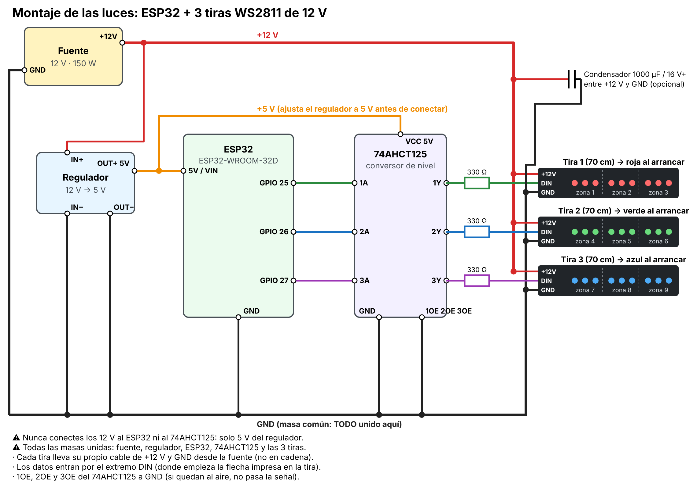

# Firmware de luces (ESP32)

Programa para un **ESP32 (ESP32-WROOM-32D, «ESP32D»)** que recibe los comandos de la app por
**UDP** (protocolo en [`docs/protocolo_luces.md`](../docs/protocolo_luces.md)) y los ejecuta en
**3 tiras × 3 secciones = 9 zonas**, con los mismos efectos que el simulador del navegador.

| Pieza | Elección | Por qué |
|---|---|---|
| LEDs | **FastLED** 3.7 | En el ESP32 usa el periférico RMT: las 3 tiras se envían por hardware, sin bloquear la CPU |
| Recepción | **AsyncUDP** (incluida en el núcleo Arduino del ESP32) | Por eventos en la tarea de red, sin sondear |
| JSON | **ArduinoJson** 7 | El analizador más rápido y ligero para microcontroladores |
| Latencia | Wi-Fi sin ahorro de energía, cola entre recepción y dibujo, 200 fps | El ahorro de energía del Wi-Fi añade decenas de ms |

La lógica de los efectos (`src/lights_core.cpp`) no depende de Arduino y se prueba en el PC:
`tests/test_esp32_core.py` la compila con `g++` y ejecuta `test_host/test_core.cpp`.

## Montaje (WS2811 de 12 V, fuente de 12 V / 150 W)



```
Fuente 12 V ──┬──────────── +12 V tira 1, tira 2, tira 3 (cada tira con su cable desde la fuente)
              ├─ conversor DC-DC 12 V → 5 V ── pin 5V (VIN) del ESP32
              └─ GND ────── GND de las 3 tiras y GND del ESP32  (MASA COMÚN, imprescindible)

ESP32 GPIO 25 ── 330 Ω ── DIN tira 1
ESP32 GPIO 26 ── 330 Ω ── DIN tira 2
ESP32 GPIO 27 ── 330 Ω ── DIN tira 3
```

- **No conectes los 12 V al ESP32.** Aliméntalo con un conversor DC-DC (buck) de 12 V a 5 V al pin
  5V/VIN, o por USB mientras pruebas (con la masa unida a la de la fuente igualmente).
- Los datos entran por el extremo **DIN** de la tira (flecha impresa en la tira).
- Resistencia de 330 Ω en serie en cada línea de datos, cerca del ESP32. Si una tira parpadea o
  no responde (el ESP32 da 3,3 V), pon un conversor de nivel 74AHCT125 alimentado a 5 V.
- Condensador de 1000 µF (16 V o más) entre +12 V y GND en la entrada de las tiras.
- En `include/config.h`: `PIXELS_PER_STRIP` (en WS2811 de 12 V, 1 píxel = 1 chip = 3 LEDs;
  70 cm a 60 LEDs/m ≈ 14 píxeles), `COLOR_ORDER` (comprueba con el barrido de arranque: tira 1
  roja, 2 verde, 3 azul), brillo y pines. Las 3 secciones se reparten los píxeles (14 → 4 + 5 + 5).
  `lights.layout.leds_per_section` de `config/config.json` solo afecta al dibujo del simulador.

## Compilar y subir (PlatformIO)

PlatformIO descarga solo la plataforma ESP32 y las librerías con las versiones fijadas en
`platformio.ini`.

```powershell
pip install platformio          # una vez (o la extensión «PlatformIO IDE» de VS Code)
cd esp32\rkbx_lights
pio run -t upload               # compila y sube (con la placa conectada por USB)
pio device monitor              # monitor serie a 115200
```

Si no detecta el puerto, instala el driver USB de la placa (CP210x o CH340, según el chip que
lleve) y, si hace falta, mantén pulsado **BOOT** al empezar la subida.

Con **Arduino IDE**: placa «ESP32 Dev Module», instala *FastLED* y *ArduinoJson* desde el
gestor de librerías, crea un sketch `rkbx_lights` y copia dentro `src/main.cpp` (renombrado a
`rkbx_lights.ino`), `src/lights_core.cpp`, `include/lights_core.h`, `include/config.h` y, si la usas,
`include/secrets.h`.

## Uso

1. Al arrancar hace un barrido (tira 1 roja, 2 verde, 3 azul) para comprobar el cableado y el orden
   de color, y queda en reposo con destellos suaves.
2. Red (en este orden):
   - **Wi-Fi de casa**: copia `include/secrets.example.h` como `include/secrets.h` y pon tu
     red y clave (ese archivo no se sube a GitHub). Al arrancar intenta conectarse durante 15 s;
     el monitor serie muestra `Conectado a … · IP …`. El PC debe estar en la misma red.
   - **Wi-Fi propia**: si no hay `secrets.h` o no conecta, crea **RKBX-LUCES** (clave
     `rekordbox`) en `192.168.4.1`. Conecta el PC a ella.
   - En los dos casos se anuncia como **`rkbx-luces.local`** (mDNS). La app envía por defecto a
     `["rkbx-luces.local", "192.168.4.1"]` (`lights.esp32_ip`), así que lo encuentra sola. Si
     Windows no resuelve `rkbx-luces.local`, fija la IP en `config.h` (`WIFI_STA_STATIC_IP`) o
     pon la IP del monitor serie en `lights.esp32_ip`.
3. Prueba desde el PC:
   ```powershell
   python -m rkbx_practice lights send flash color=rojo dur_ms=500
   python -m rkbx_practice lights send chase color=naranja bpm=128 zones=odd
   ```
4. En la ventana de la app marca **Luces** y calibra con **Latencia…**.

Sin Wi-Fi también se puede probar por USB: en `pio device monitor` escribe un JSON por línea, por
ejemplo `{"fx":"wave","color":"azul","color2":"morado","bpm":128}`.

El monitor serie muestra cada 10 s: paquetes recibidos, inválidos, perdidos, fps y el último BPM
de `sync`. El LED de la placa parpadea con cada comando.
